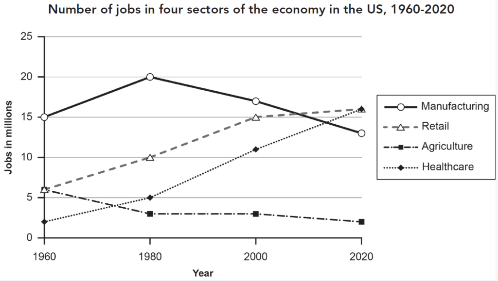

# pomile 口袋英语 —— 雅思写作复盘
### Pomile IELTS Writing Studio · Official Production Release (v1.0.0)

<p align="center">
  
</p>

<p align="center">
  <strong>基于刻意练习与母语级升格的雅思写作深度复盘系统</strong><br>
  <em>An Advanced Deliberate-Practice & Corpus-Driven Studio for IELTS Writing Band 7.5+ Mastery</em>
</p>

<p align="center">
  
  
  
  
</p>

---

## 📖 目录 / Table of Contents
1. [项目简介 / Project Overview](#-项目简介--project-overview)
2. [双级系统架构 / Two-Level Architecture](#-双级系统架构--two-level-architecture)
3. [核心功能特性 / Core Features](#-核心功能特性--core-features)
4. [AI 考官对接协议与标准 Prompt / AI Scoring Protocol & Standard Prompt](#-ai-考官对接协议与标准-prompt--ai-scoring-protocol)
5. [数据结构规范 / JSON Schema Contract](#-数据结构规范--json-schema-contract)
6. [快速开始与部署 / Quick Start & Deployment](#-快速开始与部署--quick-start--deployment)
7. [目录结构 / Directory Structure](#-目录结构--directory-structure)
8. [开源许可 / License](#-开源许可--license)

---

## 🌟 项目简介 / Project Overview

### 中文
**pomile 口袋英语 —— 雅思写作复盘** 是一款专为雅思考生与英语高级学术写作者打造的高密度、沉浸式、刻意练习复盘系统。平台摒弃传统“仅阅读范文”的被动学习方式，确立了**“原题回溯 ➔ 初稿分级诊断 ➔ 7.5+ 范文段落精读 ➔ 逐句默写誊写 ➔ 四维语料联动”**的闭环复盘体系。

平台采用 **Local-First（本地优先）** 纯静态架构，所有数据均持久化保存在用户浏览器本地，无需依赖任何后端数据库，零配置、零隐私泄露风险，随时随地在任何现代浏览器中极速运行。

### English
**Pomile IELTS Writing Studio** is a high-density, immersive, deliberate-practice analysis studio engineered specifically for IELTS candidates and academic English writers. Instead of passively browsing model essays, Pomile enforces a closed-loop mastery workflow: **"Exam Prompt Grounding ➔ Color-Coded Error Diagnostic ➔ Band 7.5+ Authentic Essay Immersion ➔ Sentence-Level Transcription Practice ➔ Real-Time Bilingual Corpus Synchronization"**.

Built on a **Local-First** pure client-side architecture, all data is securely persisted within the user's browser via LocalStorage. Zero backend required, zero privacy concerns, and instantly deployable on GitHub Pages or executable offline.

---

## 🏛️ 双级系统架构 / Two-Level Architecture

```
┌─────────────────────────────────────────────────────────────────────────────┐
│                       LEVEL 1: 篇目管理大厅 (PORTAL DASHBOARD)                │
│  [pomile Brand]    [📋 一键复制 AI 阅卷 Prompt]    [➕ 上传/导入新篇目]      │
│  ┌──────────────────┐  ┌──────────────────┐  ┌──────────────────┐          │
│  │ 📊 Task 1 折线图 │  │ 🏙️ Task 2 大作文 │  │ 📈 Task 1 表格题 │          │
│  │ 5.0 ➔ 7.5+  [入] │  │ 5.5 ➔ 7.0+  [入] │  │ 5.5 ➔ 7.5+  [入] │          │
│  │ 进度: 100% [🗑️]  │  │ 进度: 40%  [🗑️]  │  │ 进度: 0%   [🗑️]  │          │
│  └──────────────────┘  └──────────────────┘  └──────────────────┘          │
└──────────────────────────────────────┬──────────────────────────────────────┘
                                       │ 点击进入 / Click to Enter
                                       ▼
┌─────────────────────────────────────────────────────────────────────────────┐
│                    LEVEL 2: 三栏沉浸复盘工作台 (WORKSPACE STUDIO)            │
│  [◀ 返回篇目大厅]  [当前篇目标题]                           [誊写进度: 60%] │
├───────────────────────┬───────────────────────┬─────────────────────────────┤
│   LEFT (37%): 诊断    │   MIDDLE (30%): 范文  │     RIGHT (33%): 誊写与语料  │
│ ┌───────────────────┐ │ ┌───────────────────┐ │ ┌─────────────────────────┐ │
│ │ 📌 题目要求 &     │ │ │ Band 7.5+ 范文正文│ │ │ ⌨️ 范文誊写输入对话框   │ │
│ │ 🖼️ 原题大图直出   │ │ │ (自然学术段落流)  │ │ │ (实时准确率比对/Enter)  │ │
│ ├───────────────────┤ │ │                   │ │ ├─────────────────────────┤ │
│ │ 📑 初稿分段文本   │ │ │ 句句可点，高亮联动│ │ │ 💎 当前句专属高分语料库 │ │
│ │ 🎯 点到哪个错误   │ │ │ [#1] [#2] [#3]... │ │ │ • 📊 趋势动态/数据表达   │ │
│ │    才在底下出解析 │ │ │                   │ │ │ • 🔀 逻辑连接/篇章路标   │ │
│ └───────────────────┘ │ └───────────────────┘ │ │ • 💎 高分句法/地道搭配   │ │
│                       │                       │ │ • 🛡️ 初稿硬伤/避坑替换   │ │
│                       │                       │ └─────────────────────────┘ │
└───────────────────────┴───────────────────────┴─────────────────────────────┘
```

---

## ⚡ 核心功能特性 / Core Features

| 模块 / Module | 中文功能解析 | English Description |
| :--- | :--- | :--- |
| **自适应屏幕配比**<br>Adaptive Proportions | 彻底告别生硬三等分，按信息重要度重构为 **左 37%（大图与诊断） \| 中 30%（范文阅读） \| 右 33%（誊写与语料）**，字号全面提升至 13.5px。 | Breaks rigid 33% columns. Optimized as **Left 37% \| Middle 30% \| Right 33%**, with generous 13.5px typography for supreme legibility. |
| **原题大图完整直出**<br>Full Exam Prompts | 折线图、柱状图、多表格题高分辨率完整呈现，杜绝截断与微缩，刻度、图例一目了然。 | High-res full exam charts rendered without cropping or severe downscaling. Axes, legends, and numbers clearly legible. |
| **点选触发错误诊断**<br>Click-to-Inspect Diagnostics | 原文错误用五色彩标标注。**光标点中哪个错误标签，下方专属卡片才即刻展开对应失分剖析、扣分原理与 7 分改法**，界面极致清爽。 | Error tags are colored. Clicking an error exclusively reveals its diagnostic, examiner rationale, and Band 7.5+ fix below. |
| **自然学术段落流**<br>Natural Essay Flow | 范文以真实学术段落排布，消除厚重框中框。每句话带有独立标号 `[#1]`，点击即可毫秒级联动右栏。 | Model essays flow as continuous natural academic paragraphs. Sentences are individually clickable to sync with the right column. |
| **实时打字誊写引擎**<br>Real-Time Typing Engine | 输入时逐字比对匹配率（Accuracy %），支持 <kbd>Enter</kbd> 自动验证跳句、一键填入与进度持久化记录。 | Instant character-by-character typing accuracy validation, <kbd>Enter</kbd> auto-advance, autofill, and progress storage. |
| **中英分行四维语料库**<br>Four-Dimensional Corpus | 每一句范文拆解出四大语料模块（趋势数据、逻辑转折、句法搭配、初稿避坑），**中英文严格换行并附带考官深度点拨**。 | Every sentence yields 4 lexical modules (Trends, Transitions, Syntax, Pitfalls) with explicit English/Chinese line separation. |
| **篇目全生命周期管理**<br>Full Catalog Lifecycle | 第一级大厅支持查看篇目、**一键删除任意篇目**、**一键清空重置为空白纯净版**，或随时恢复官方示例。 | Manage all essays from the portal: one-click delete on any card, clear all for a blank studio, or restore default samples. |

---

## 🤖 AI 考官对接协议与标准 Prompt / AI Scoring Protocol

平台支持与任意顶级大语言模型（**ChatGPT 4o**, **Claude 3.5 Sonnet**, **Gemini 1.5/2.0 Pro**）深度联动。点击平台首页顶部的 **`📋 一键复制 AI 阅卷 Prompt`**，即可直接复制以下标准提示词。

### System Prompt for AI Evaluator (中英双语版)

```markdown
# 角色与任务定义 / Role & Mission
你是一位拥有15年官方评卷经验的资深前雅思考官（IELTS Senior Examiner）与母语级写作教学教练。
我将为你提供【雅思写作题目要求（Prompt）】以及我的【初稿原文（Original Draft）】。
你的任务是：
1. 按照雅思官方四维标准（TA/TR, CC, LR, GRA）对我的初稿进行极其严格、一针见血的失分诊断。
2. 给出 7.5+ 分官方升格重写范文（按段落排布，句句地道精悍，符合母语学术规范）。
3. 提取每一句用到的高分专属语料（趋势动态、逻辑连接、高分句法、避坑替换，且中英文严格换行）。
4. 将所有内容输出为【完全匹配我前端交互学习平台的标准 JSON 数据包】，严禁省略字段，不要输出任何额外的闲聊解释，只输出一个合法的 JSON 代码块！

---

# 必须遵循的 JSON 输出格式（请完整输出合法的 JSON 代码块）

```json
{
  "title": "篇目名称（例如：篇目四：全球可再生能源趋势 (Task 1)）",
  "taskType": "Academic Task 1 (或 Task 2) · 具体图表/题型",
  "score": "初稿预估: 5.0 ➔ 升格后: 7.5+",
  "prompt": "题目完整英文题干",
  "chartHtml": "<div class='w-full h-full p-4 flex items-center justify-center text-slate-400 italic text-xs'>[图表概要提示]</div>",
  "originalDraft": [
    {
      "pIndex": 0,
      "pTitle": "段落 1 · 改写与引言",
      "textHtml": "初稿第1段文本。其中的每一个错误单词或短语，必须用 <span class=\"error-tag err-xxx\" onclick=\"selectIssue(错误序号)\">错词</span> 包裹。错误类型样式名：err-gra(语法), err-spelling(拼写), err-ta(数据/看反), err-lr(词汇搭配), err-cc(衔接)。序号从 0 递增。",
      "issues": [
        {
          "target": "原文错词错句",
          "type": "err-gra (对应上方样式名)",
          "cat": "分类标签（如：语法硬伤 (GRA)）",
          "diag": "详尽失分剖析与考官扣分原理",
          "fix": "7分官方推荐替换改法",
          "rule": "一句话避坑背诵口诀"
        }
      ]
    }
  ],
  "modelParagraphs": [
    {
      "pTitle": "段落 1 · 题目改写与引言",
      "sentences": [
        {
          "globalIndex": 0,
          "text": "范文第一句话（英文完整句，末尾保留标点）。",
          "corpus": {
            "trends": [
              {
                "en": "本句中使用的趋势动词/数据比例/极值英文短语",
                "zh": "精准地道的中文翻译与语境功能说明",
                "note": "考官青睐原因与得分点解析"
              }
            ],
            "transitions": [
              {
                "en": "本句中使用的段落衔接词/逻辑转折词",
                "zh": "逻辑连接词中文释义与篇章功能",
                "note": "上下文连贯与承上启下解析"
              }
            ],
            "syntax": [
              {
                "en": "本句核心高分语法结构/学术搭配模板",
                "zh": "句式结构中文说明与框架提炼",
                "note": "主从复合/分词伴随/名词化解析"
              }
            ],
            "pitfalls": [
              {
                "en": "❌ 初稿错法 ➔ ✅ 范文地道改法",
                "zh": "正误对比与失分雷区说明",
                "note": "考场动笔前防踩坑提示"
              }
            ]
          }
        }
      ]
    }
  ]
}
```

---

# 严格执行准则 / Execution Rules
1. modelParagraphs 中的 sentences 数组必须包含范文的全部句子，globalIndex 从 0 开始全局连续累加（0, 1, 2, 3...）。
2. originalDraft 中的 textHtml 错词 span 里的 selectIssue(i) 的参数 i 必须与该段 issues 数组的索引一一对应。
3. 语料提取务必中英换行分明，en 填写纯正地道英文词块，zh 说明功能，note 提供考官视角深度解析。
4. 确保输出的 JSON 语法 100% 正确，不要输出任何额外的闲聊解释文字。
```

---

## 🚀 快速开始与部署 / Quick Start & Deployment

### 本地直接运行 / Run Locally
1. 克隆或下载本项目到本地。
2. 双击打开 `index.html`，无需安装任何运行环境或依赖，支持 Chrome, Safari, Edge, Firefox。

```bash
git clone https://github.com/leolei11/pomile-ielts-writing.git
cd pomile-ielts-writing
open index.html
```

### GitHub Pages 一键上线 / Deploy to GitHub Pages
1. 在 GitHub 仓库页面点击 **Settings** ➔ **Pages**。
2. 在 **Branch** 下选择 `main` 分支，路径选择 `/(root)`，点击 **Save**。
3. 约 1 分钟后，即可通过 `https://<your-username>.github.io/pomile-ielts-writing/` 全球公网访问。

---

## 📂 目录结构 / Directory Structure

```
pomile-ielts-writing/
├── index.html              # 核心单页应用 (Single-Page Application: 大厅+三栏复盘台)
├── README.md               # 官方中英对照产品说明文档
├── .gitignore              # Git 忽略配置
└── assets/                 # 静态多媒体资源
    ├── t1_line_graph.png   # Task 1 美国四大行业折线图原题图片
    └── t1_nyc_tables.png   # Task 1 纽约200年总人口三张表格原题图片
```

---

## 📜 开源许可 / License

本项目基于 [MIT License](LICENSE) 开源。欢迎个人考生备考使用或机构用于雅思写作精细化复盘教学。

Copyright (c) 2026 **pomile 口袋英语团队**. All rights reserved.
